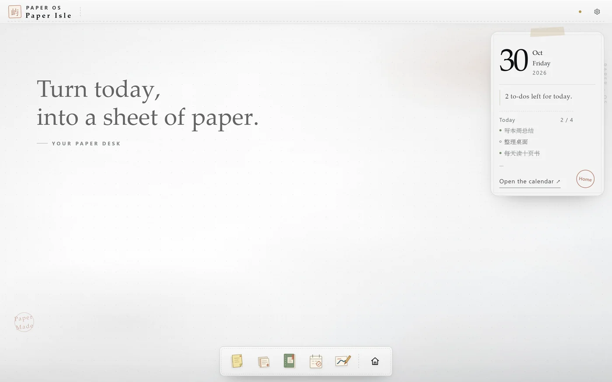
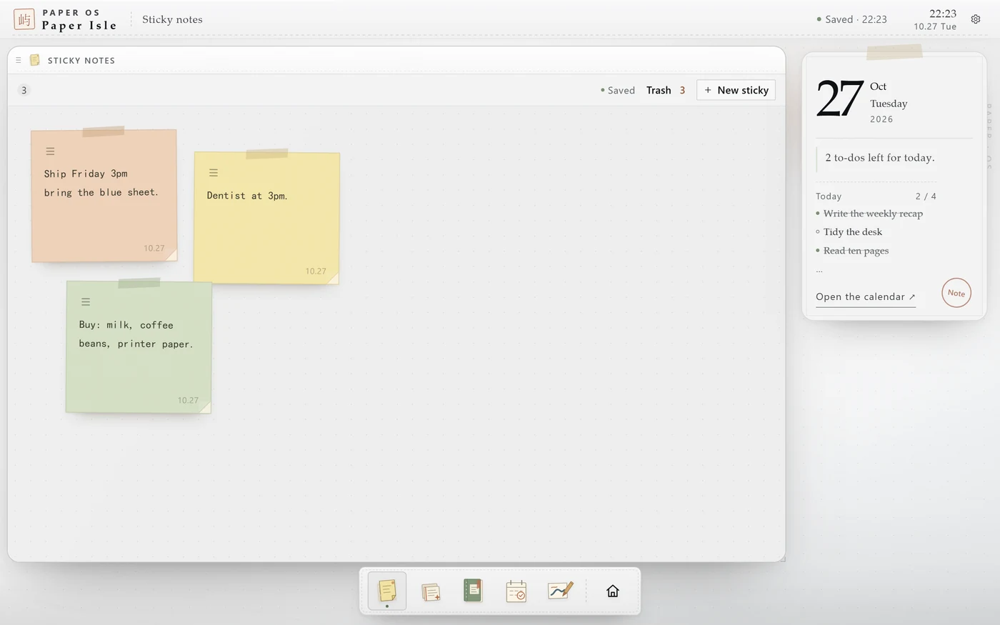
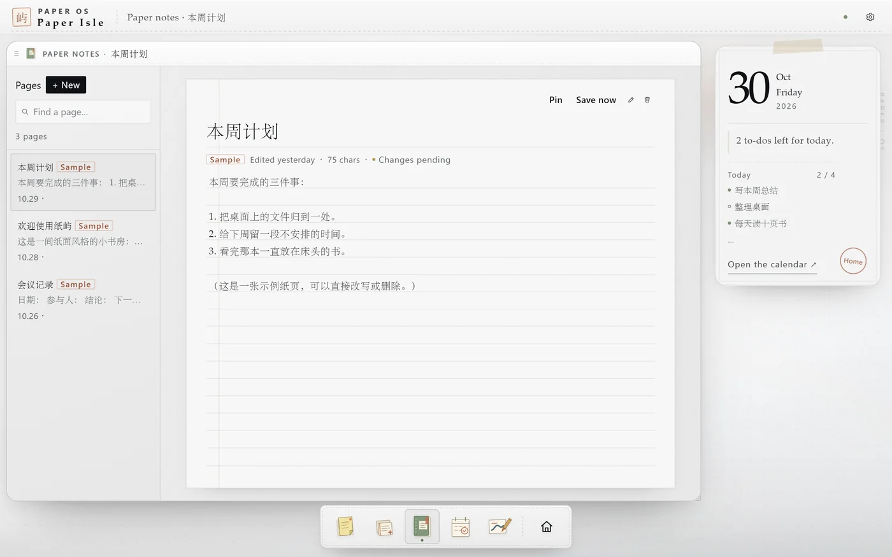
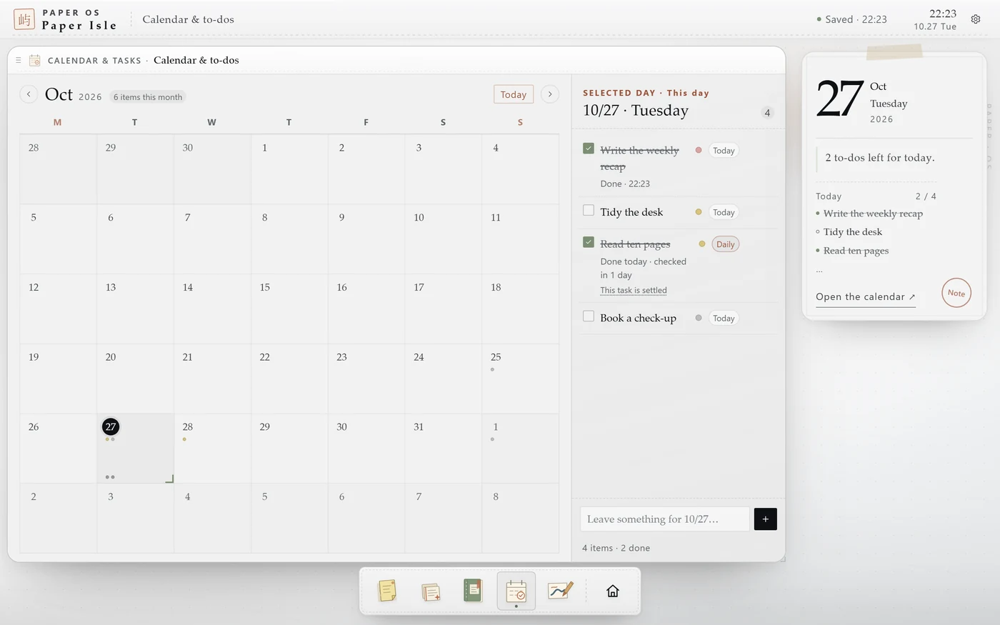
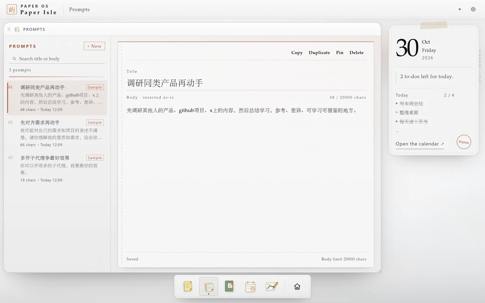
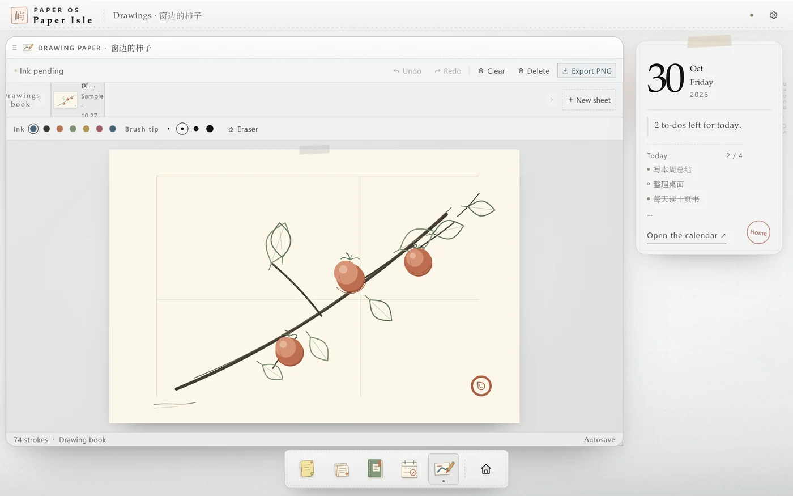
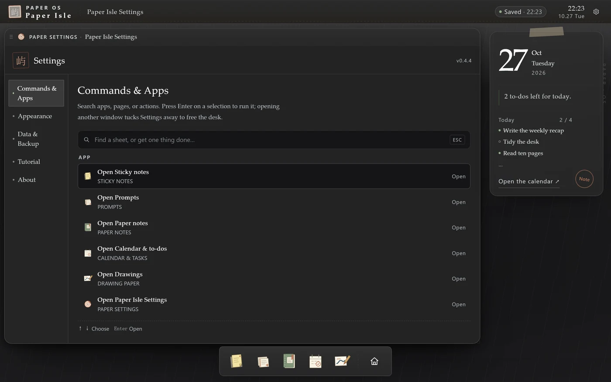
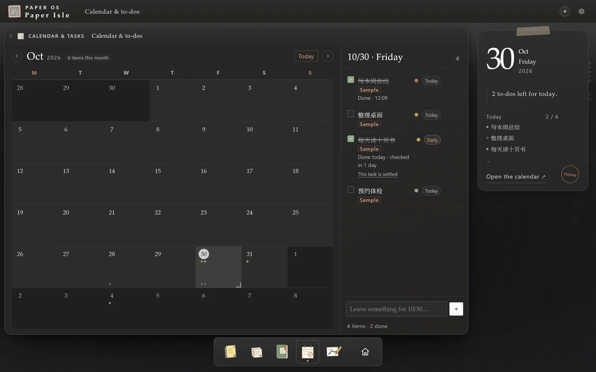

# dsh-plugin-control-your-schedule · 纸屿 (Paper Isle)


> Sticky notes, paper pages, calendar tasks, drawings and a reusable prompt library — all inside the DeepSeek Harness sidebar.
> A paper-style personal desk: your data stays on this machine, nothing is uploaded.
>
> panel plugin v0.4.4

[](https://github.com/HaoyanZhang123/dsh-plugin-control-your-schedule/actions/workflows/ci.yml)
[](https://github.com/HaoyanZhang123/dsh-plugin-control-your-schedule/releases)
[](https://www.npmjs.com/package/dsh-plugin-control-your-schedule)
[](LICENSE)

Version **0.4.4** · Built against DSH **0.2.1-rc.2** · Tested on Windows; macOS / Linux are covered by the CI build and static gates | English / 中文 UI | 语言：[中文](README.md)



## Overview

Paper Isle is a DSH panel plugin: a small paper desk that lives in the left sidebar of DeepSeek Harness. Notes, pages, calendar tasks, drawings and prompts share one desk — windows move and resize freely, and everything saves itself.

It is deliberately quiet: no floating toasts, no empty status rows, and no network access. Content is written to the DSH data directory, while the browser keeps a cache for fast startup.

## Features

- **Sticky notes**: one-line memos that save as you type. **The whole card is draggable** (except the text area, scrollbar, colour dots and delete key), and the card you touched last always stays on top. The body uses the bundled **LXGW WenKai** handwriting face; you can switch to a system running script or a serif face in Settings.



- **Trash for stickies**: deleting a note does not pop an undo toast; the card goes to the trash at the top of the sticky window and stays for **7 days**, ready to restore. Empty cards are discarded immediately.
- **Paper pages**: long-form writing with a searchable list on the left and autosave. A new page keeps its title as a placeholder, so an untouched page never leaves a stray untitled line behind.



- **Calendar & tasks**: every task carries one of **four urgency levels** (urgent and important / important not urgent / urgent not important / neither), switchable **right on the task row**: tap the dot for the four levels, tap the chip beside it to flip between “today only” and “every day”. The detail dialog is optional.
- **Calendar dots**: unfinished tasks sit above the day number, coloured by level; **finished ones sink to the bottom of the cell and turn grey**, and never swap places.
- **Repeating tasks**: choose “every day” and each day produces exactly one current instance from the anchor date; checking in today grows a fresh instance tomorrow. Only days actually checked in keep a grey dot — future days are never pre-filled. When the last instance is checked, “this task is done” appears; collapse it and no new instances grow, with the option to restore, showing “checked in N days”.



- **Prompt library**: the fifth app on the dock. Search and pin on the left; write a title and a multi-line body on the right, saved automatically. Body limit 20 000 characters, up to 300 entries, with duplicate/pin/delete (delete asks first).
- **Use prompts from the composer**: every conversation input has a small “Prompts” button on the left of its tool row. It opens a list above the composer — arrow keys to move, Enter to fill, Esc to close. **It only fills the draft**: an empty draft takes the whole prompt, a non-empty one gets it at the caret (undoable in one step); while the message is sending it asks you to wait. It never writes a system prompt and never sends anything. “Manage in Paper Isle ↗” jumps to the plugin with the prompt window open.



- **A quiet interface**: no floating toasts; status rows with nothing to say do not take up space.
- **Drawing paper**: pen and eraser, undo, export to PNG; the shelf pages left and right and can delete a whole sheet.



- **Fixed right rail**: today's card always sits on the right; windows live in the work area and never cover it.
- **Dock**: the single entry point for every app. Tap an icon to open or tuck away its window; **icons can be dragged into a new order** (`Alt + ←/→` moves the focused icon too, the order is remembered, and Settings → Appearance → “Reset” restores it). The house button on the right tucks every window away, and brings them back when tapped again.
- **Tidy the desk**: tapping empty desk space also tucks every window into the dock (windows are kept, tap an icon to bring one back).
- **Commands & Apps**: the first section in Settings, one keystroke away with `Ctrl/Cmd + K`. Search apps, pages or actions, `↑↓` to move, `Enter` to run; once something else opens, Settings tucks itself away.



- **Plain windows**: no minimise/maximise/close buttons — drag the title bar to move and the bottom-right corner to resize. Close the current window with `Esc`, `Ctrl/Cmd + Alt + W`, or Settings → Commands & Apps → “Close current window”.
- **First-run tour**: a six-step tour plays on first open; replay it from Settings → Shortcuts → “Play again”.
- **Backup**: Settings → Data & Backup exports and imports the whole workspace as JSON.
- **Colours that match DSH**: desk, windows, panels and inset surfaces take the host's own colours, and text follows the DSH label scale. Three modes: **Follow DSH** (default — the panel follows the host's light/dark switch live, no refresh needed), Light, and Dark. The plugin only reads the host theme signal and never writes the host DOM, so it does not clash with skin plugins.
- **Dark mode, reworked**: paper grain is removed in dark mode, and desk, windows and panels sit on a real brightness ladder; sticky cards keep their colours but a step lighter instead of turning muddy.
- **Paper grain can be turned off**: Settings → Appearance → “Paper grain”. Off is a flat surface; on adds a very fine paper texture.



- **Upgrades never lose data**: the workspace is versioned with a migration ladder, v1 → v2 → v3 (v3 only adds the prompt library). Before writing, the host saves the previous version as `workspace.v<old>.backup.json` and keeps `workspace.prev.json` for every write. A workspace that fails validation opens **read-only** with the original kept aside — an example desk never overwrites it.
- **Switching away does not lose state**: come back from another DSH view and the windows, the selected page, the calendar day, the sticky scroll position, the open drawing and the Settings section are all where you left them.

## Installation

### npm (recommended, one package name)

DSH → Plugins → Add plugin, then enter:

```
dsh-plugin-control-your-schedule
```

A version can be pinned too: `dsh-plugin-control-your-schedule@0.4.4`.

### GitHub (alternative, without npm)

```
https://github.com/HaoyanZhang123/dsh-plugin-control-your-schedule
```

### Local development

DSH → Plugins → Add plugin, then enter the **absolute path** of this directory:

```
<path to the repo>/dsh-plugin-control-your-schedule
```

> Add plugin accepts absolute local paths only; relative paths are rejected.
> Installed plugins do not update themselves: upgrading means uninstall, then install the new version.

After installing, “便签” appears in the left sidebar under Plugins / Automated tasks. If it does not, refresh the page; replacing an installed package needs a DSH restart.

> npm: <https://www.npmjs.com/package/dsh-plugin-control-your-schedule>

## Usage

| What you want | How to do it |
|---|---|
| Open an app | Tap a dock icon, or press `Ctrl/Cmd + K` and search |
| Tuck away / restore a window | Tap the dock icon again |
| Tuck every window away | Tap the house button, or tap empty desk space |
| Close the current window | `Esc` / `Ctrl/Cmd + Alt + W` / Settings → Commands & Apps → “Close current window” |
| Reorder the dock | Drag an icon; or focus it and press `Alt + ←/→` |
| Replay the tour | Settings → Shortcuts → “Play again” |
| Back up data | Settings → Data & Backup → “Export workspace” |

## Where the data lives

- **DSH data directory (primary)**: `$DSH_HOME/control-your-schedule/workspace.json`
  - Windows default: `C:\Users\<you>\.dsh\control-your-schedule\workspace.json`
  - If `DSH_HOME` is set, that directory wins.
- **Browser cache (fallback)**: IndexedDB / localStorage, for fast startup.
- Moving to another machine: export JSON in Settings, then import it there.

## Compatibility

- Built against DSH **0.2.1-rc.2**.
- Verified on Windows 11 + DSH 0.2.1-rc.2: install, sidebar, panel, data kept after refresh and view switches, host persistence, export/import.
- CI runs the build, page contract, DOM nesting, host route and client syntax checks on **Windows / macOS / Ubuntu** runners.
- **Not tested on a real macOS / Linux DSH**: shortcut labels switch to ⌘/⌥ automatically; data paths use `DSH_HOME` or `~/.dsh`; there are no platform-specific binaries. Please open an issue if something breaks.
- The UI ships in English and Chinese: it follows DSH Settings → General → Language by default, and Settings → Appearance → Language can override it for Paper Isle alone; windows and whatever each app was showing come back after a switch. The sidebar entry is “便签” in Chinese and “Sticky” in English.
- Both pages are built from one Chinese source; sample content uses the language active when it was created, and anything you wrote is never translated.

## Development

```bash
# Build client.js (embeds assets/paper-os.html into the client bundle)
python tools/build_page.py

# Check that the bundle matches its sources (used by CI)
python tools/build_page.py --check

# Project gates (page contract + DOM nesting + build + migration + host route)
python smoke/run_all_checks.py

# Include a real browser (needs Edge/Chrome; without --cdp the suite counts as SKIP, not a pass)
python smoke/run_all_checks.py --cdp

# Migration and in-browser page checks on their own
node smoke/migrate_test.mjs
node smoke/page_e2e.mjs
```

| Path | Purpose |
|---|---|
| `index.js` | Host half: reads and writes `/api/control-your-schedule/workspace` into the DSH data directory |
| `src/client.src.js` | Client half: sidebar entry, main panel, iframe bridge |
| `assets/paper-os.html` | The paper page (single source of the UI) |
| `client.js` | Build output — do not edit by hand |
| `tools/build_page.py` | Build script |
| `smoke/run_all_checks.py` | Project gates |
| `smoke/host_route_test.mjs` | Host persistence route, upgrade backup, font route |
| `smoke/migrate_test.mjs` | Migration gate: v1 snapshot to v2, field by field, with negative cases |
| `smoke/page_e2e.mjs` | Real-browser page checks (headless browser, 127 assertions across both pages) |
| `assets/fonts/` | Bundled handwriting subset (LXGW WenKai, OFL) with source and licence |

### Design choices

- The UI is not rewritten in React: the original page is mounted in a same-origin iframe, so window dragging, autosave and keyboard behaviour stay as they are.
- Write twice: the page writes to browser storage for instant use, then hands the snapshot to the host route over `postMessage`; on reopen the newer snapshot wins.
- One load gate: host snapshot, IndexedDB, localStorage, the recovery journal and imports all go through `ingestWorkspace` (migration ladder plus strict current-version validation) — there is no second version comparison.
- Repeating tasks use a template plus read-time projection instead of materialising daily instances: crossing midnight redraws and writes nothing, and counts naturally stay at one.
- The theme is read, never written: it reads `body[data-ds-dark-theme]` and follows host switches through a `MutationObserver`; if unavailable it falls back to `prefers-color-scheme`.
- Colours come from the host's real tokens: an iframe does not inherit the parent's CSS variables, so the page reads `--dsw-alias-*` from `parent.document.body` at runtime; host values are used only in “Follow DSH” mode, an explicit Light/Dark choice wins.
- No third-party runtime dependencies; the host uses Node built-ins only and the build uses the Python standard library. The font subsetting script additionally needs `fonttools` (development only; the subset is committed).

## Releases & License

- [CHANGELOG.md](CHANGELOG.md)
- [Releases](https://github.com/HaoyanZhang123/dsh-plugin-control-your-schedule/releases)
- MIT — see [LICENSE](LICENSE)
