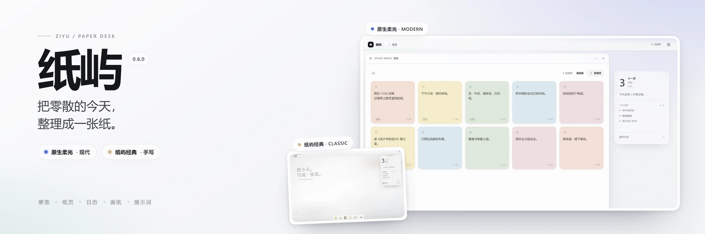
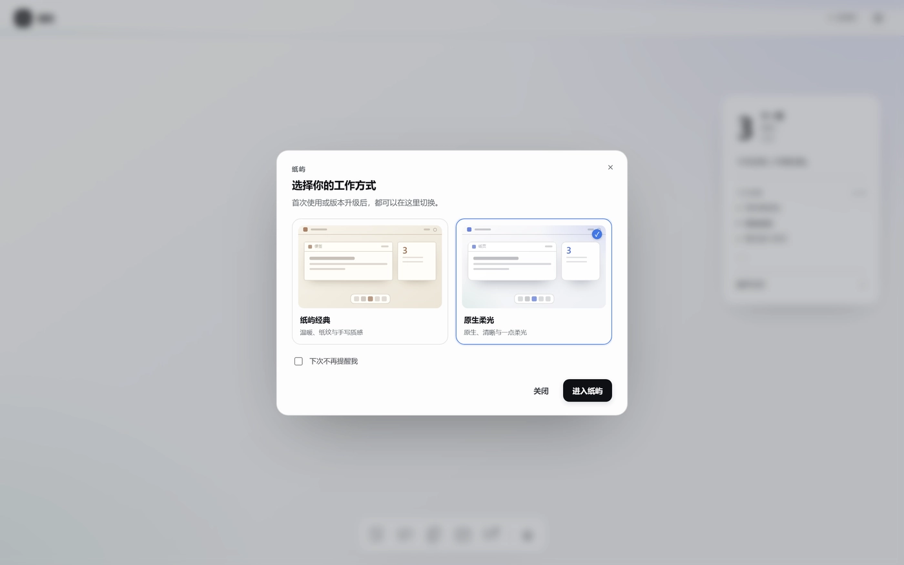
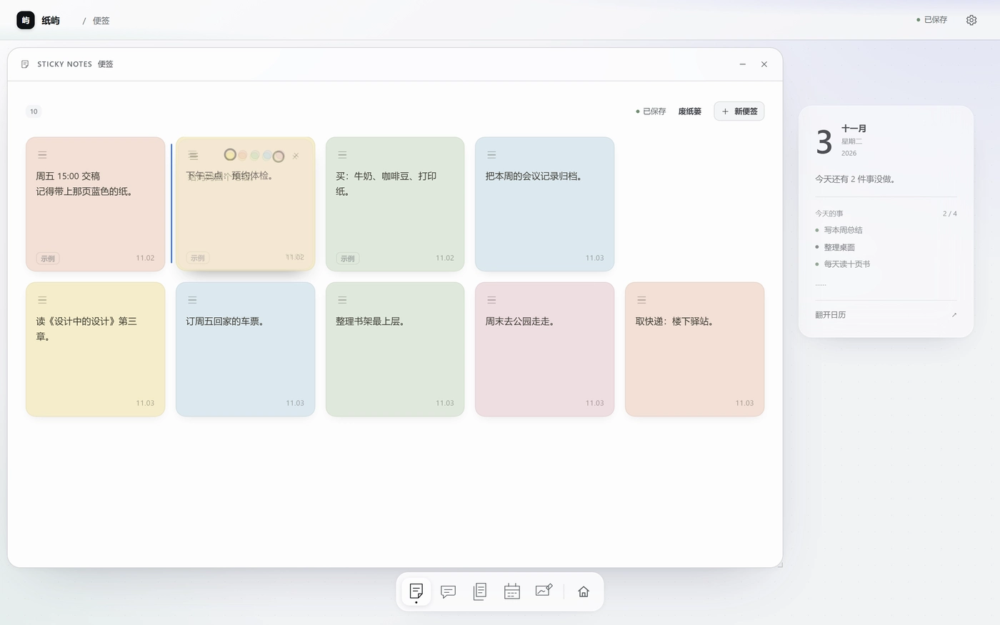
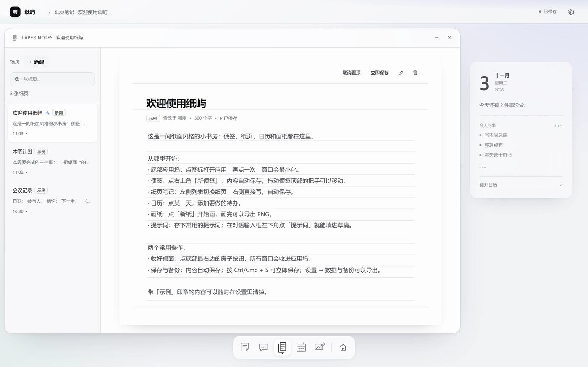
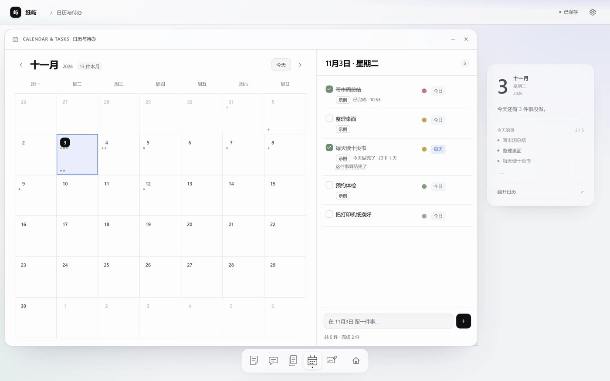
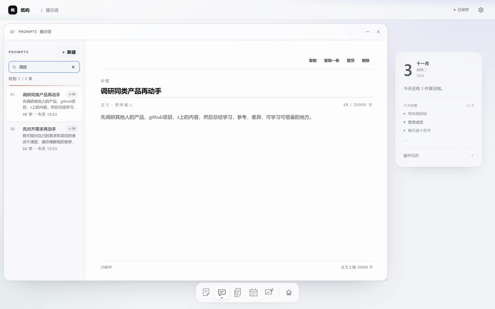
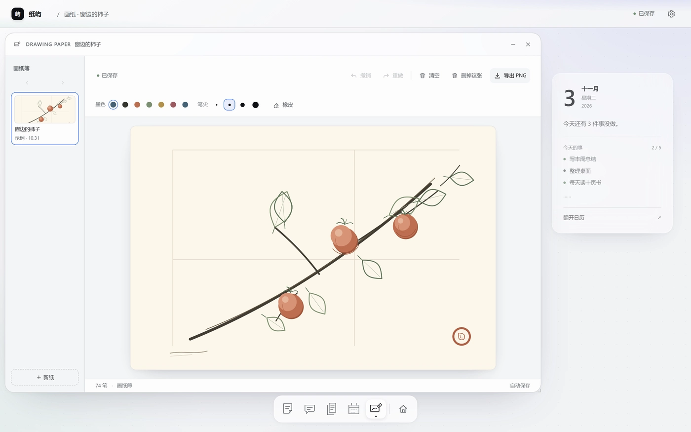

<p align="center">
  
</p>

<h1 align="center">Paper Isle</h1>
<p align="center">Sticky notes, paper pages, calendar tasks, drawings and a reusable prompt library on one desk inside DSH.</p>
<p align="center"><a href="README.zh.md">中文</a></p>

> panel plugin v0.6.1

<p align="center">
  <a href="https://nodejs.org/"></a>
  <a href="https://developer.mozilla.org/docs/Web/JavaScript"></a>
  <a href="https://developer.mozilla.org/docs/Web/API/IndexedDB_API"></a>
  <a href="https://www.python.org/"></a>
</p>

<p align="center">
  <a href="https://github.com/HaoyanZhang123/dsh-plugin-control-your-schedule/actions/workflows/ci.yml"></a>
  <a href="https://github.com/HaoyanZhang123/dsh-plugin-control-your-schedule/releases"></a>
  <a href="https://www.npmjs.com/package/dsh-plugin-control-your-schedule"></a>
  <a href="LICENSE"></a>
</p>

## Overview

Paper Isle is a sidebar panel plugin for DeepSeek Harness. It puts a personal desk into the left panel: **sticky notes, paper pages, calendar tasks, drawings and a reusable prompt library** live in one place, windows move and resize freely, everything saves itself, and the data never leaves your machine.

It stays quiet on purpose: no floating toasts, no empty status rows, a theme that follows DSH, and a dark mode rebuilt for paper. It is for people who want a local, offline, exportable workspace without leaving DSH.

## Features

### Two skins, one product

Since 0.6.0 there are two skins with identical features, only the look differs: **Paper Isle Classic** (`classic`, the default for existing workspaces — paper surface, handwriting, freely placed notes) and **Native Glow** (`modern` — no tape, stamp or paper grain; a very light blue-violet / teal ambience; DSH-native tokens; sticky notes become an ordered grid you can drag, or reorder with `Alt + ←/→`).

Switch in Settings → Appearance → "Desk look". It applies instantly without a page reload; windows, unsaved edits, search terms, the selected calendar day and the current drawing page all survive. A fresh install asks once, each upgrade asks once more, and "Don't remind me again" stops it for good.



### Sticky notes

- Short thoughts, saved automatically; **the whole sheet can be dragged** (except the body text, scrollbar, colour swatches and delete button), and the one you touched last stays on top.
- The body uses the bundled **LXGW WenKai** handwriting face; you can switch to a system face or a paper serif in Settings.
- **The trash keeps notes for 7 days** instead of showing an undo toast — deleted notes land in the trash at the top of the sticky window and can be put back at any time. Empty notes are dropped immediately.



### Paper pages

- Long-form writing with a searchable page list on the left and auto-save.
- A new page's title is a placeholder, not a line of literal "Untitled page".
- **Pinning**: the editor toolbar has Pin / Unpin with `aria-pressed`; pinned pages sort first, the rest stay newest-first. Pinning survives reload, export/import and migration.



### Calendar and tasks

- Every task has **four urgency levels** (urgent and important / important / urgent / none), switched **in place** on the task row without opening a detail dialog.
- **Calendar dots**: unfinished dots sit under the day number and take the level colour; finished dots sink to the bottom of the cell and turn neutral.
- **Persistent tasks**: a "daily" task reappears once a day from its anchor date; checking in today grows a new unfinished instance tomorrow, while the calendar only shows days you actually checked in. Future dates are never pre-filled. Finishing the run shows "this one is done", stops new instances and can be restored at any time.



### Prompt library and composer entry

- **Library**: the fifth dock app, seeded with five sample prompts. Search and pin from the list, edit title and multi-line body on the right, auto-saved. Body limit 20,000 characters, up to 300 prompts. New / duplicate / pin / delete, with confirmation on delete.
- **Use it while chatting**: every composer has a small "Prompts" button on the left of its tool row. It opens a list above the input; `↑↓` selects, `Enter` fills, `Esc` closes. **It only fills the draft**: an empty draft receives the whole prompt, a non-empty one gets an insert at the caret (single-step undo); a sending composer asks you to try again in a moment. It never writes the system prompt and never sends by itself.



### Drawing paper

- Freehand drawing with undo/redo, eraser, brush colours and four tip sizes, clear page, delete whole page and export to PNG; the booklet flips left/right and remembers the current page.



### Desk, windows and dock

- **Today card** on the right of a wide desk so windows never cover it; it steps aside on narrow panels.
- **Dock**: the only entry point to the apps; click toggles a window; **icons can be dragged to reorder** (or `Alt + ←/→` when focused; the order is remembered and can be reset in Settings → Appearance). The house button gathers every window, and pressing it again restores them.
- **Clicking empty desk** also gathers all windows into the dock (nothing is destroyed).
- **Commands and apps**: the first item in Settings, reachable with `Ctrl/Cmd + K`; search apps, pages or actions, `↑↓` to select, `Enter` to run.
- **Windows**: Classic has no minimise / maximise / close triple; drag the title bar to move and the bottom-right corner to resize; close with `Esc`, `Ctrl/Cmd + Alt + W` or the command list. Native Glow adds explicit minimise and close buttons in the title bar, wired to the same window manager actions.
- **First-run tour**: six steps, replayable from Settings → Tutorial.

### Theme and appearance

- **Colours follow DSH**: desk, windows, popovers and insets take the host's own colours and the DSH label scale; Follow DSH (default, live) / Light / Dark. The plugin only reads the host theme signal and never writes the host DOM.
- **Dark mode was rebuilt**: paper grain is removed in dark mode and desk, windows and popovers sit on a real brightness ladder.
- **Paper grain can be turned off**; paper grain and the hand-written sticky font are classic-only — hidden in Native Glow, values kept, restored on switch back.

### Data and upgrades

- **Upgrades keep your data**: the workspace carries a version and a migration ladder (v1 → v4). The host writes `workspace.v<old>.backup.json` before a version change and keeps `workspace.prev.json` before every write. A workspace that fails validation opens **read-only** with the original stashed — it is never overwritten with the sample desk.
- **Switching away and back** restores windows and what each app was looking at (selected page, calendar day, sticky scroll, drawing page, settings section).

## Installation

The plugin is installed into DSH itself. DSH does not auto-update installed plugins: upgrading means uninstalling and reinstalling.

### From npm (recommended)

DSH → Plugins → Add plugin, then enter:

```text
dsh-plugin-control-your-schedule
```

A version can be pinned too: `dsh-plugin-control-your-schedule@0.6.1`.

### From GitHub

```text
https://github.com/HaoyanZhang123/dsh-plugin-control-your-schedule
```

### From a local checkout

Point Add plugin at the absolute path of this directory:

```text
<your checkout>/dsh-plugin-control-your-schedule
```

After installing, "便签 / Notes" appears in the left sidebar under Plugins. If it does not, refresh the page; replacing an installed package requires restarting DSH.

## Usage

| Goal | How |
|---|---|
| Open an app | Click a dock icon, or press `Ctrl/Cmd + K` and search |
| Collapse / restore a window | Click the same dock icon again |
| Gather every window | Click the house button, or click empty desk |
| Close the focused window | `Esc` / `Ctrl/Cmd + Alt + W` / Settings → Commands |
| Reorder the dock | Drag an icon, or focus it and press `Alt + ←/→` |
| New page / sticky / drawing / calendar | `Ctrl/Cmd + Alt + N / B / D / C` |
| Save now | `Ctrl/Cmd + S` |
| Replay the tour | Settings → Tutorial |
| Back up data | Settings → Data → Export workspace |

State is kept per app, so switching back to DSH and returning puts you where you left off.

## Configuration

### Where the data lives

- **DSH data directory (primary)**: `$DSH_HOME/control-your-schedule/workspace.json` — on Windows that defaults to `%USERPROFILE%\.dsh\control-your-schedule\workspace.json`.
- **Browser storage (fallback)**: IndexedDB / localStorage for a fast first paint.
- Moving machines: export the workspace as JSON in Settings and import it on the other side.

### Language, theme and motion

- The UI follows DSH's own language setting by default; Settings → Appearance → Language pins Chinese or English for the desk only. Switching rebuilds the desk and restores what you were looking at.
- Theme: Follow DSH (default) / Light / Dark. Motion: follow system or reduce animations.
- Paper grain, sticky font, desk grid and desk look live under Settings → Appearance.

## Compatibility

- Built against DSH **0.2.1-rc.2**.
- Tested on Windows 11 with DSH 0.2.1-rc.2: install, sidebar, panel, data retention across reload and view switches, host persistence, export/import.
- CI builds and runs the page contract, DOM nesting, host route and client syntax checks on **Windows, macOS and Ubuntu** runners.
- **Not yet exercised on a real macOS or Linux DSH**: the data path uses `DSH_HOME` or `~/.dsh` and there are no platform-specific binaries. Please open an issue if something breaks.
- Chinese and English pages are built from one source; sample content is generated in the language of first creation, and your own text is never translated.

## Project structure

| Path | Purpose |
|---|---|
| `index.js` | Host half: `/api/control-your-schedule/workspace` read/write plus the bundled font route |
| `src/client.src.js` | Client half: sidebar entry, panel, iframe bridge, composer entry |
| `assets/paper-os.html` | The desk page — the single UI source |
| `client.js` | Build output, generated — never edit by hand |
| `tools/build_page.py` | Build: embeds the page into the client and injects the version |
| `smoke/run_all_checks.py` | Project gate (page contract, DOM nesting, build, migration, host route) |
| `smoke/page_e2e.mjs` | Real-browser checks (headless Edge/Chrome), both skins and the upgrade path |
| `smoke/k3_stickies_test.mjs` | Sticky data and pointer-drag contracts |
| `smoke/classic_visual_regression.mjs` | Pixel comparison of the classic skin against the previous release |
| `assets/i18n/en.json`, `en.templates.json` | English dictionary and parameterised templates (build inputs) |
| `assets/fonts/` | Bundled handwriting subset (LXGW WenKai, OFL) with its licence |

## Development

```bash
# Build client.js (embeds assets/paper-os.html into the client bundle)
python tools/build_page.py

# Verify the bundle matches its sources (used by CI)
python tools/build_page.py --check

# Project gate
python smoke/run_all_checks.py

# Add real-browser suites (needs Edge or Chrome; without it they are SKIP, not a pass)
python smoke/run_all_checks.py --cdp
```

### Design notes

- The UI is not rewritten in React: the page is mounted in a same-origin iframe so dragging, auto-save and keyboard handling keep working unchanged.
- Two writes: the page writes browser storage first for instant use, then posts the snapshot to the host route, which persists it to the DSH data directory; the newer snapshot wins on reload.
- A single load gate: host snapshot, IndexedDB, localStorage, recovery journal and imported files all go through `ingestWorkspace` (migration ladder + strict validation of the current version).
- Persistent tasks are a template plus a read-time projection, not materialised daily rows — crossing midnight only redraws.
- Themes are read-only: the plugin reads the host's `data-ds-dark-theme` and follows it live with a `MutationObserver`.
- Host colours are read at runtime from the parent document's `--dsw-alias-*` variables, because an iframe does not inherit the parent's custom properties.
- No third-party runtime dependencies; the host uses Node built-ins and the build uses the Python standard library.

## Releases

- Current version: **0.6.1**
- [CHANGELOG.md](CHANGELOG.md) · [Releases](https://github.com/HaoyanZhang123/dsh-plugin-control-your-schedule/releases) · [npm](https://www.npmjs.com/package/dsh-plugin-control-your-schedule)

## License

MIT, see [LICENSE](LICENSE).
