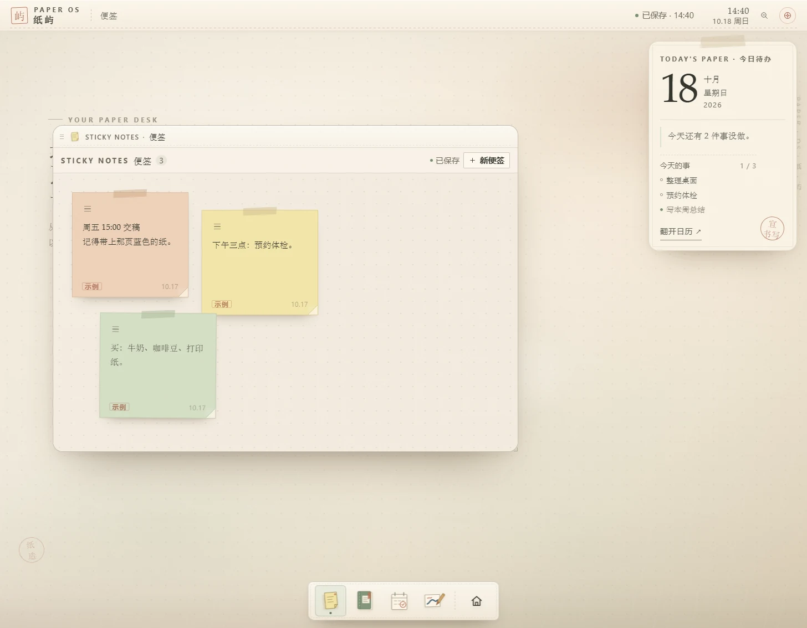

# dsh-plugin-control-your-schedule · 纸屿

> 把便签、纸页笔记、日历待办和画纸，装进 DeepSeek Harness 的左侧栏。
> 纸面风格的个人工作台：数据保存在本机，不联网。

[](https://github.com/HaoyanZhang123/dsh-plugin-control-your-schedule/actions/workflows/ci.yml)
[](https://github.com/HaoyanZhang123/dsh-plugin-control-your-schedule/releases)

当前版本 **0.1.3** · 开发依据 DSH **0.2.1-rc.2** · Windows 实测，macOS / Linux 由 CI 构建与静态门禁覆盖




## 功能

- **便签**：短句速记，自动保存；拖动便签顶部左侧的把手移动，正文区域不会误触。
- **纸页笔记**：长文写作，左侧列表搜索/切换，自动保存。
- **日历与待办**：按日期添加待办，完成后勾选；右侧「今日纸签」同步摘要。
- **画纸**：手写/绘画，支持撤销、橡皮、导出 PNG。
- **固定右侧栏**：今日纸签始终在右侧，窗口只在左侧工作区活动，不会被遮住。
- **底部应用坞**：所有应用的唯一入口；点图标打开/收起窗口；最右边的房子按钮一键收好全部窗口，再点一次恢复。
- **点桌面收好**：点击窗口外的空白桌面，也会把全部窗口收进应用坞（不销毁窗口，点图标可恢复）。
- **纯净窗口**：没有最小化/最大化/关闭三件套；拖标题栏移动，拖右下角缩放。关闭当前窗口用 `Esc`、`Ctrl/Cmd + Alt + W` 或命令面板的「关闭当前窗口」。
- **新手导览**：首次打开自动播放 6 步导览；可在「设置 → 快捷键 → 新手导览」重播。
- **数据备份**：设置 → 数据与备份，导出/导入完整工作区 JSON。

## 安装

### GitHub（当前可用）

DSH → Plugins → Add plugin，填：

```
https://github.com/HaoyanZhang123/dsh-plugin-control-your-schedule
```

### 本地开发

DSH → Plugins → Add plugin，填本目录的**绝对路径**：

```
<仓库路径>/dsh-plugin-control-your-schedule
```

> Add plugin 只接受绝对路径；相对路径会被拒绝。
> 已安装的插件不支持自动更新：升级 = 卸载后重装新版。

安装后左侧栏「插件 / 自动化任务」下面会出现「便签」。如果没有出现，刷新页面；替换已安装的包需要重启 DSH。

> npm 包已按发布要求准备好，但 **暂未发布**（本机访问 npm registry 超时）。请优先使用上面的 GitHub 地址。

## 使用

| 想做什么 | 怎么做 |
|---|---|
| 打开应用 | 点底部应用坞的图标 |
| 收起 / 恢复窗口 | 再点一次应用坞图标 |
| 一次收好全部窗口 | 点房子按钮，或点窗口外的空白桌面 |
| 关闭当前窗口 | `Esc` / `Ctrl/Cmd + Alt + W` / 命令面板「关闭当前窗口」 |
| 重看新手导览 | 设置 → 快捷键 → 新手导览 →「重新播放」 |
| 备份数据 | 设置 → 数据与备份 →「导出工作区」 |

## 数据存在哪里

- **DSH 数据目录（主存储）**：`$DSH_HOME/control-your-schedule/workspace.json`
  - Windows 默认：`C:\Users\<你>\.dsh\control-your-schedule\workspace.json`
  - 如果设置了 `DSH_HOME`，以该目录为准。
- **浏览器缓存（备用）**：IndexedDB / localStorage，用于页面快速启动。
- 换设备时在设置里导出 JSON，再导入即可。

## 兼容性

- 开发依据：DSH **0.2.1-rc.2**。
- 已在 Windows 11 + DSH 0.2.1-rc.2 实测：安装、侧栏、面板、刷新/切换后数据保持、宿主落盘、导出/导入路径。
- CI 在 **Windows / macOS / Ubuntu** 三个 runner 上执行构建、页面契约、DOM 嵌套、宿主路由与客户端语法检查。
- **未在 macOS / Linux 真机 DSH 上实测**：快捷键标签会自动使用 ⌘/⌥；数据路径使用 `DSH_HOME` 或 `~/.dsh`；没有平台专属二进制。发现问题请提 issue。
- 页面为中文界面；插件列表中的英文名称为 “Sticky”。

## 开发

```bash
# 构建 client.js（把 assets/paper-os.html 内嵌进客户端包）
python tools/build_page.py

# 校验产物是否与源码一致（CI 用）
python tools/build_page.py --check

# 项目门禁（页面契约 + DOM 嵌套 + 构建 + 宿主路由持久化）
python smoke/run_all_checks.py
```

| 路径 | 作用 |
|---|---|
| `index.js` | Host 半边：`/api/control-your-schedule/workspace` 读写 DSH 数据目录 |
| `src/client.src.js` | Client 半边：侧栏入口、主面板、iframe 桥接 |
| `assets/paper-os.html` | 纸屿页面（唯一 UI 源） |
| `client.js` | 构建产物，禁止手改 |
| `tools/build_page.py` | 构建脚本 |
| `smoke/run_all_checks.py` | 项目门禁 |
| `smoke/host_route_test.mjs` | Host 持久化路由测试 |

### 设计取舍

- UI 不重写成 React：原页面用同源 iframe 隔离挂载，窗口拖拽、自动保存与键盘交互保持原样。
- 数据双写：页面先写浏览器存储保证即时可用，再通过 `postMessage` → Host 路由落盘到 DSH 数据目录；重开时选择较新的快照。
- 无第三方运行时依赖；Host 只用 Node 内置模块，构建只用 Python 标准库。

## 更新日志与许可

- [CHANGELOG.md](CHANGELOG.md)
- [Releases](https://github.com/HaoyanZhang123/dsh-plugin-control-your-schedule/releases)
- MIT
