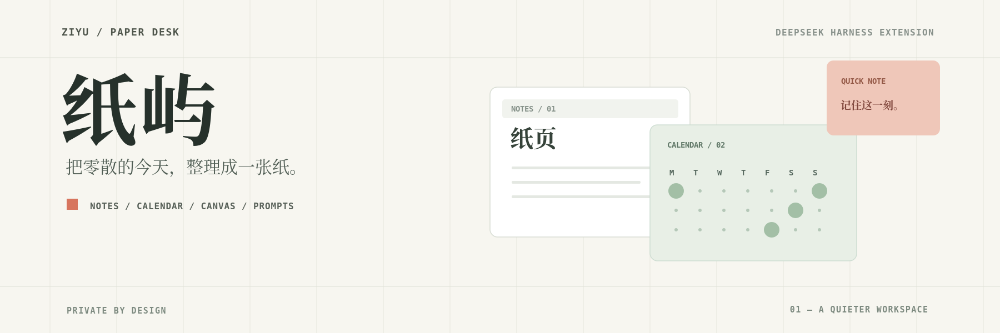
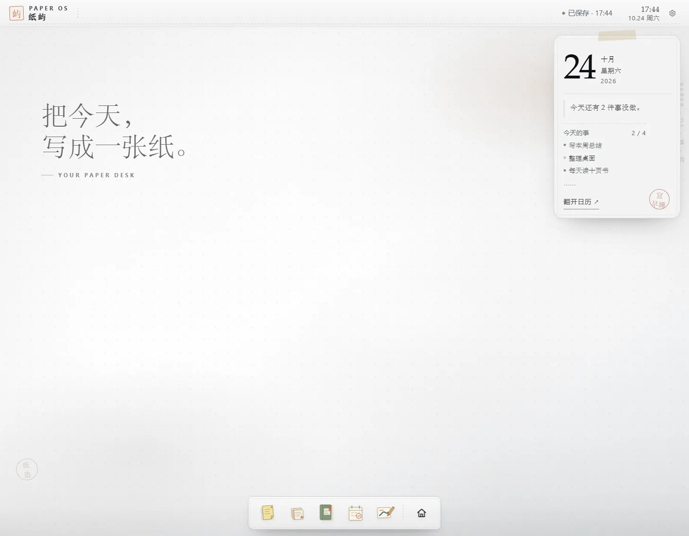
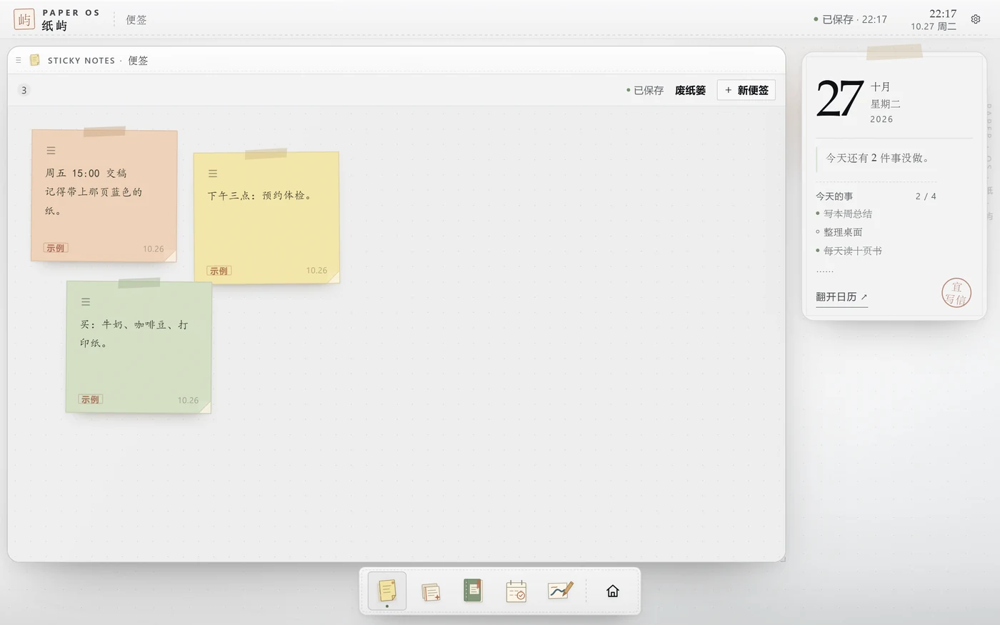
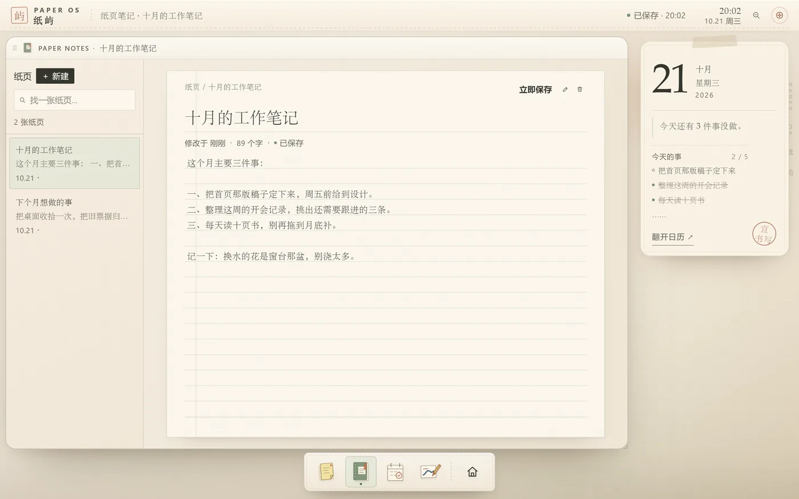
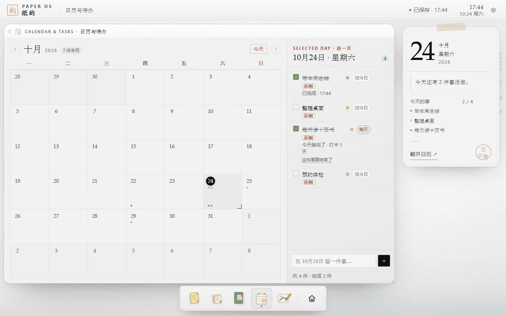
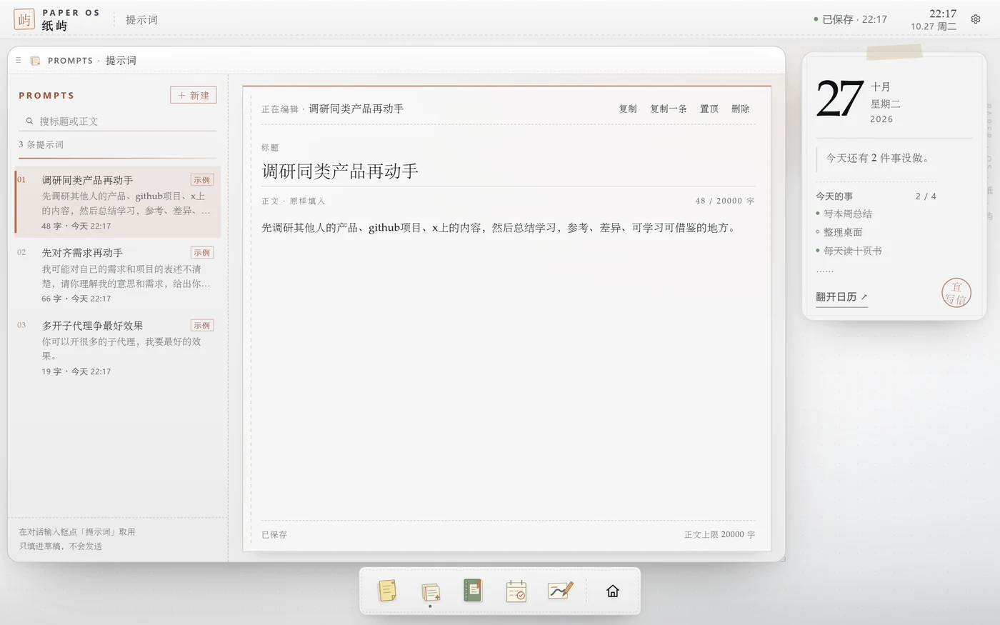
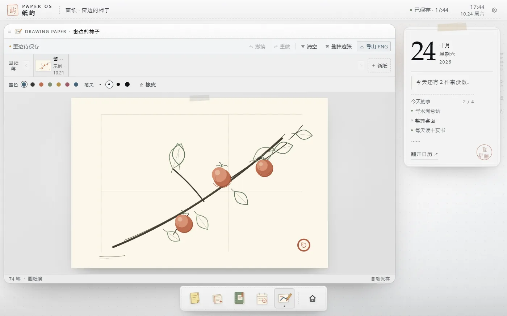
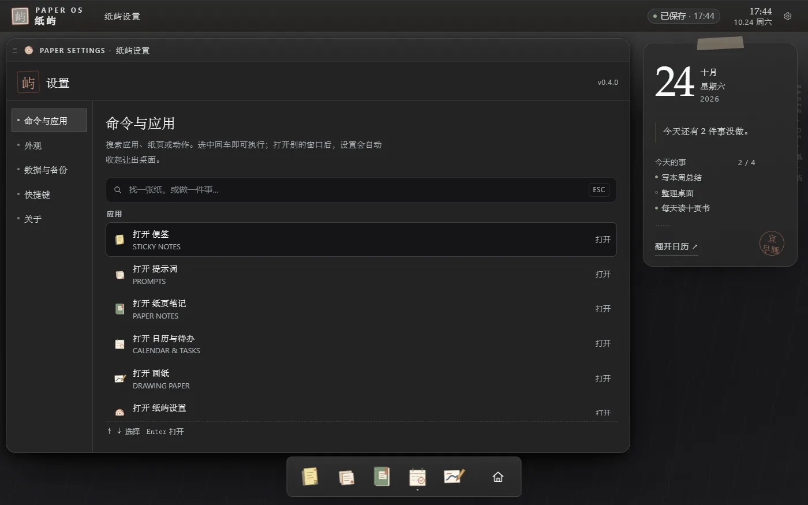
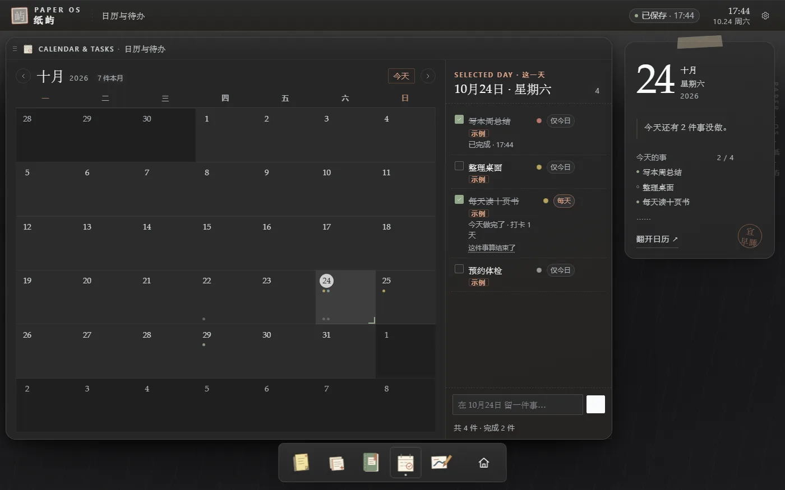

# dsh-plugin-control-your-schedule · 纸屿



> 把便签、纸页笔记、日历待办、画纸和常用提示词，装进 DeepSeek Harness 的左侧栏。
> 纸面风格的个人工作台：数据保存在本机，不联网。
>
> 面板插件 v0.5.0

[](https://github.com/HaoyanZhang123/dsh-plugin-control-your-schedule/actions/workflows/ci.yml)
[](https://github.com/HaoyanZhang123/dsh-plugin-control-your-schedule/releases)
[](https://www.npmjs.com/package/dsh-plugin-control-your-schedule)
[](LICENSE)

当前版本 **0.5.0** · 开发依据 DSH **0.2.1-rc.2** · Windows 实测，macOS / Linux 由 CI 构建与静态门禁覆盖 | 界面中英双语 | 语言：[English](README.en.md)



## 功能

- **便签**：短句速记，自动保存；**整张纸都能拖着走**（正文、滚动条、色块、删除键除外），最后碰过的那张永远在最上面。正文默认使用内置**霞鹜文楷**手写体，可在设置里换成系统行楷或纸张宋体。



- **废纸篓**：删掉的便签不弹「撤销」提示，而是进便签窗口顶部的废纸篓，**留 7 天**，随时放回去；空便签直接丢弃。
- **纸页笔记**：长文写作，左侧列表搜索/切换，自动保存。新纸页的标题像正文一样是 placeholder，不写字不会留下一行「未命名纸页」。



- **日历与待办**：每件事有**四档紧急程度**（重要且紧急 / 重要但不紧急 / 紧急但不重要 / 不紧急也不重要），**在待办行右侧就地切换**：点色点弹出四档选择（选中即生效），点旁边的胶囊在「仅今日 / 每天」之间切换，都不用进详情。
- **日历圆点**：未完成的点在上、按档位着色；**完成的点沉到格子底部并变灰**，位置固定不换位。
- **持久待办**：选「每天」后，从锚定日起**每天出现一条当前实例**，今天打卡后第二天自动长出一条未完成的新实例；日历上只留真正打过卡的日子（灰点），未来不铺。勾完当天会出现「这件事算结束了」，收起后不再长新实例、随时可恢复，并显示「打卡 N 天」。



- **提示词库**：应用坞第 5 个应用。左列表搜索、置顶优先；右编辑器写标题与多行正文，自动保存。正文上限 20000 字，最多 300 条。新建/复制一条/置顶/删除，删除有确认。
- **对话里随取随用**：每个对话输入框工具行左侧有一个「提示词」小按钮，点开上方弹出列表，↑↓ 选择、Enter 填入、Esc 关闭。**只填进草稿**：草稿为空时整段填入，非空时插到光标处（单步可撤销），输入框正在发送会提示稍后再试。不写系统提示词、不自动发送。点「在便签里管理 ↗」会切到纸屿并打开提示词窗口。



- **安静的界面**：不弹浮层提示；没有信息的状态行不占位。
- **画纸**：手写/绘画，支持撤销、橡皮、导出 PNG；画纸簿可左右翻页，也能整张删掉。



- **固定右侧栏**：今日纸签始终在右侧，窗口只在左侧工作区活动，不会被遮住。
- **底部应用坞**：所有应用的唯一入口；点图标打开/收起窗口；**图标可以拖动排序**（聚焦后按 `Alt + ←/→` 也能挪，顺序会记住；设置 → 外观 →「恢复默认」还原）；最右边的房子按钮一键收好全部窗口，再点一次恢复。
- **点桌面收好**：点击窗口外的空白桌面，也会把全部窗口收进应用坞（不销毁窗口，点图标可恢复）。
- **命令与应用**：设置左栏第一项，`Ctrl/Cmd + K` 直达。搜索应用、纸页或动作，`↑↓` 选择、`Enter` 执行；打开别的窗口后设置会自动收起，不挡路。



- **纯净窗口**：没有最小化/最大化/关闭三件套；拖标题栏移动，拖右下角缩放。关闭当前窗口用 `Esc`、`Ctrl/Cmd + Alt + W`，或「设置 → 命令与应用 → 关闭当前窗口」。
- **新手导览**：首次打开自动播放 6 步导览；可在「设置 → 快捷键 → 新手导览」重播。
- **数据备份**：设置 → 数据与备份，导出/导入完整工作区 JSON。
- **配色跟 DSH 一致**：桌面、窗口、浮层、凹槽这些大色块直接用宿主自己的颜色，文字按 DSH 的 label 阶梯取；**跟随 DSH**（默认，宿主切深色时面板实时跟着变，不用刷新）/ 浅色 / 深色三档可选。插件只读宿主主题信号，不写宿主 DOM，和别的皮肤插件不冲突。
- **深色是重做过的**：深色下去掉纸纹噪点，桌面比窗口暗一档、浮层再亮一档；便签纸保留自己的颜色但提亮了明度，不再糊成一片。
- **纸纹可关**：设置 → 外观 →「纸纹」。关掉是纯色底，打开有极细的纸颗粒。



- **升级不丢数据**：工作区带版本号与迁移阶梯，v1 → v2 → v3 自动升级（v3 新增提示词库，只做加法）；Host 在写盘前会把旧版本另存为 `workspace.v<旧版本>.backup.json`，并在每次写入前留一份 `workspace.prev.json`。存储里的工作区若过不了校验，会**只读打开**并另存原稿，绝不拿示例桌面覆盖。
- **切换不丢状态**：切到 DSH 其它界面再回来，窗口、以及每个应用正在看的东西（选中的纸页、日历停在哪天、便签滚到哪、画纸开哪张、设置哪个分区）都会复原。

## 安装

### npm（推荐，一行包名）

DSH → Plugins → Add plugin，填：

```
dsh-plugin-control-your-schedule
```

也可以带版本：`dsh-plugin-control-your-schedule@0.5.0`。

### GitHub（备选，不需要 npm 时）

```
https://github.com/HaoyanZhang123/dsh-plugin-control-your-schedule
```

### 本地开发

DSH → Plugins → Add plugin，填本目录的**绝对路径**：

```
<仓库路径>/dsh-plugin-control-your-schedule
```

> Add plugin 对本地路径只接受绝对路径；相对路径会被拒绝。
> 已安装的插件不支持自动更新：升级 = 卸载后重装新版。

安装后左侧栏「插件 / 自动化任务」下面会出现「便签」。如果没有出现，刷新页面；替换已安装的包需要重启 DSH。

> npm：<https://www.npmjs.com/package/dsh-plugin-control-your-schedule>

## 使用

| 想做什么 | 怎么做 |
|---|---|
| 打开应用 | 点底部应用坞的图标，或按 `Ctrl/Cmd + K` 搜一下 |
| 收起 / 恢复窗口 | 再点一次应用坞图标 |
| 一次收好全部窗口 | 点房子按钮，或点窗口外的空白桌面 |
| 关闭当前窗口 | `Esc` / `Ctrl/Cmd + Alt + W` / 设置 → 命令与应用 →「关闭当前窗口」 |
| 应用坞换顺序 | 直接拖动图标；或聚焦图标后按 `Alt + ←/→` |
| 重看新手导览 | 设置 → 快捷键 → 新手导览 →「重新播放」 |
| 备份数据 | 设置 → 数据与备份 →「导出工作区」 |

## 数据存在哪里

- **DSH 数据目录（主存储）**：`$DSH_HOME/control-your-schedule/workspace.json`
  - Windows 默认：`C:\Users\<你>\.dsh\control-your-schedule\workspace.json`
  - 如果设置了 `DSH_HOME`，以该目录为准。
- **浏览器缓存（备用）**：IndexedDB / localStorage，用于页面快速启动。
- 换设备时在设置里导出 JSON，再导入即可。

## 兼容性

- 开发依据：DSH **0.2.1-rc.2**。
- 已在 Windows 11 + DSH 0.2.1-rc.2 实测：安装、侧栏、面板、刷新/切换后数据保持、宿主落盘、导出/导入路径。
- CI 在 **Windows / macOS / Ubuntu** 三个 runner 上执行构建、页面契约、DOM 嵌套、宿主路由与客户端语法检查。
- **未在 macOS / Linux 真机 DSH 上实测**：快捷键标签会自动使用 ⌘/⌥；数据路径使用 `DSH_HOME` 或 `~/.dsh`；没有平台专属二进制。发现问题请提 issue。
- 界面中英双语：默认跟随 DSH「设置 → 通用 → 语言」，也可以在「纸屿设置 → 外观 → 语言」里单独选中文 / English；切语言时窗口与正在看的内容都会恢复。插件列表里中文叫「便签」，英文叫 “Sticky”。
- 英文页面与中文页面由同一份源构建，示例内容按首次创建时的语言生成；你自己写的内容不会被翻译。

## 开发

```bash
# 构建 client.js（把 assets/paper-os.html 内嵌进客户端包）
python tools/build_page.py

# 校验产物是否与源码一致（CI 用）
python tools/build_page.py --check

# 项目门禁（页面契约 + DOM 嵌套 + 构建 + 迁移 + 宿主路由持久化）
python smoke/run_all_checks.py

# 连真机浏览器一起跑（需要本机有 Edge/Chrome；不加 --cdp 时该套件只算 SKIP，不算通过）
python smoke/run_all_checks.py --cdp

# 单独跑迁移与真机页面检查
node smoke/migrate_test.mjs
node smoke/page_e2e.mjs
```

| 路径 | 作用 |
|---|---|
| `index.js` | Host 半边：`/api/control-your-schedule/workspace` 读写 DSH 数据目录 |
| `src/client.src.js` | Client 半边：侧栏入口、主面板、iframe 桥接 |
| `assets/paper-os.html` | 纸屿页面（唯一 UI 源） |
| `client.js` | 构建产物，禁止手改 |
| `tools/build_page.py` | 构建脚本 |
| `smoke/run_all_checks.py` | 项目门禁 |
| `smoke/readme_lint.py` | README 结构（img 前后空行 / 横幅 / 本地图片） |
| `smoke/shell_theme_test.mjs` | 外壳主题契约（零暖色 / 首帧主题 / 让位变量） |
| `smoke/host_lang_test.mjs` | 宿主语言解析与字典完整性 |
| `smoke/i18n_check.py` | 英文页覆盖（CJK / 词典 / F 模板 / 脚本语法） |
| `assets/i18n/en.json` | 英文词典（构建输入，唯一中文源在 paper-os.html） |
| `assets/i18n/en.templates.json` | 带参/复数模板（F()） |
| `smoke/host_route_test.mjs` | Host 持久化路由 + 升级备份 + 字体路由测试 |
| `smoke/migrate_test.mjs` | 迁移门禁：v1 快照升 v2 后逐字段比对，含反向用例 |
| `smoke/page_e2e.mjs` | 真机页面检查（无头浏览器，中英两页 127 项断言） |
| `assets/fonts/` | 内置手写体子集（霞鹜文楷，OFL）与来源/许可 |

### 设计取舍

- UI 不重写成 React：原页面用同源 iframe 隔离挂载，窗口拖拽、自动保存与键盘交互保持原样。
- 数据双写：页面先写浏览器存储保证即时可用，再通过 `postMessage` → Host 路由落盘到 DSH 数据目录；重开时选择较新的快照。
- 单一加载闸门：Host 快照 / IndexedDB / localStorage / 恢复日志 / 导入文件全部先过 `ingestWorkspace`（迁移阶梯 + 当前版本严格校验），不存在第二条版本比较。
- 持久待办用「模板 + 读时投影」，不物化每日实例：跨天只重绘、零写盘，计数天然「只算一个」。
- 主题只读不写：读宿主 `body[data-ds-dark-theme]`，并用 `MutationObserver` 跟着宿主切换实时生效；读不到再退回 `prefers-color-scheme`。
- 颜色取宿主的真实令牌：iframe 不继承父文档的 CSS 变量，所以运行时读 `parent.document.body` 的 `--dsw-alias-*` 写回本页；只有「跟随 DSH」时才吃宿主值，手动选了浅/深色就以插件自己的为准。
- 无第三方运行时依赖；Host 只用 Node 内置模块，构建只用 Python 标准库。字体子集化脚本额外需要 `fonttools`（仅开发期，产物已入库）。

## 更新日志与许可

- [CHANGELOG.md](CHANGELOG.md)
- [Releases](https://github.com/HaoyanZhang123/dsh-plugin-control-your-schedule/releases)
- MIT
