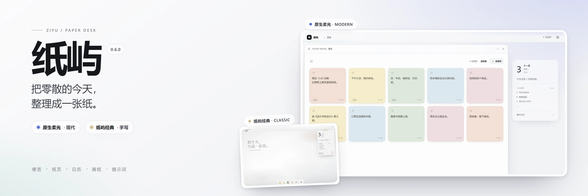
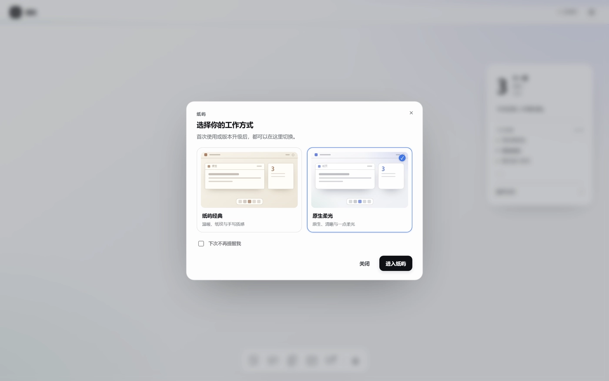
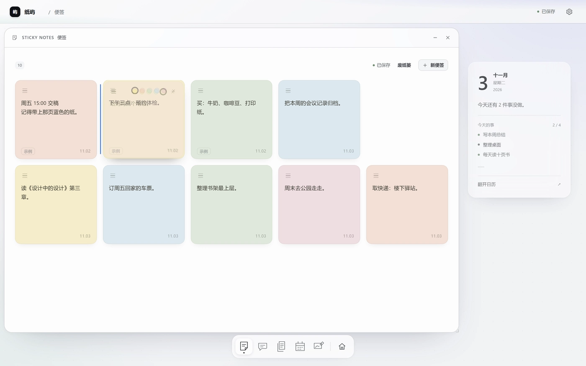
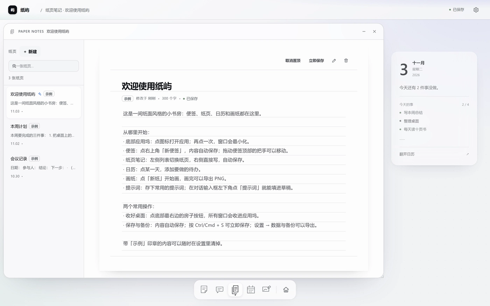
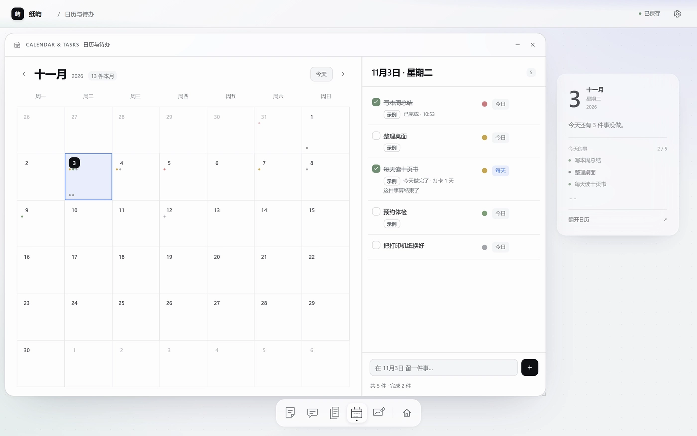
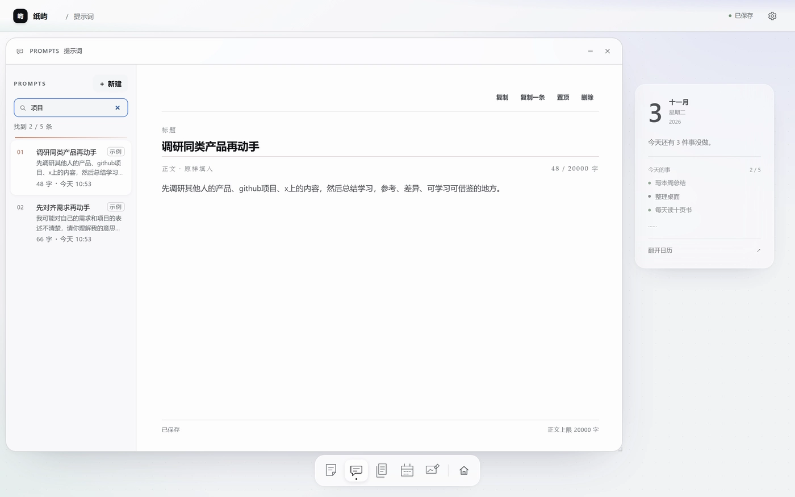
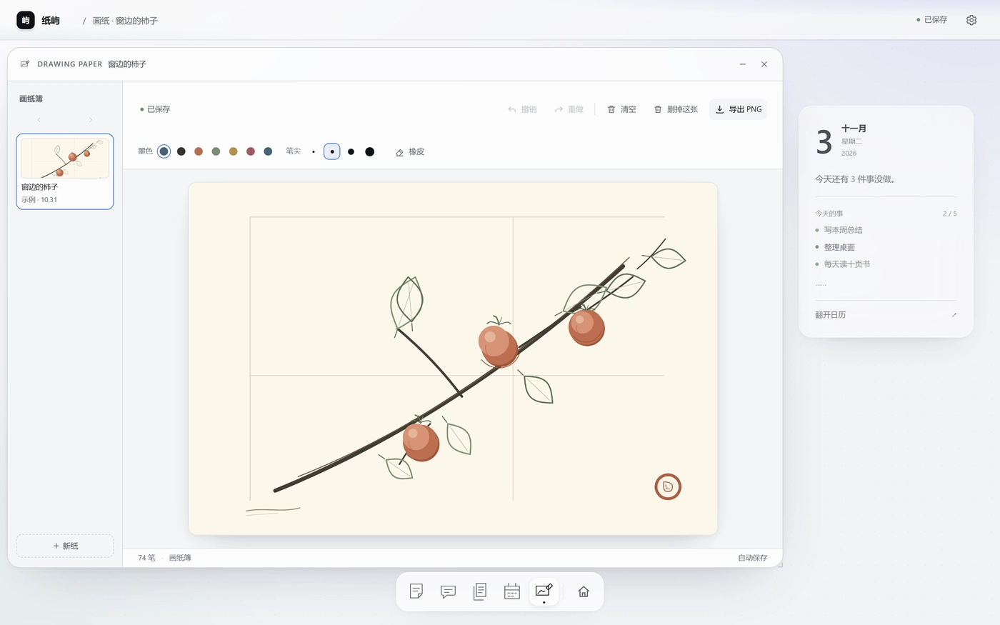

<p align="center">
  
</p>

<h1 align="center">纸屿</h1>
<p align="center">便签、纸页笔记、日历待办、画纸与常用提示词，放在 DSH 里同一张桌面上。</p>
<p align="center"><a href="README.md">English</a></p>

> 面板插件 v0.6.0

<p align="center">
  <a href="https://nodejs.org/"></a>
  <a href="https://developer.mozilla.org/docs/Web/JavaScript"></a>
  <a href="https://developer.mozilla.org/docs/Web/API/IndexedDB_API"></a>
  <a href="https://www.python.org/"></a>
</p>

<p align="center">
  <a href="https://github.com/HaoyanZhang123/dsh-plugin-control-your-schedule/actions/workflows/ci.yml"></a>
  <a href="https://github.com/HaoyanZhang123/dsh-plugin-control-your-schedule/releases"></a>
  <a href="https://www.npmjs.com/package/dsh-plugin-control-your-schedule"></a>
  <a href="LICENSE"></a>
</p>

## 简介

纸屿（Paper Isle）是 DeepSeek Harness 的侧栏面板插件：把**便签、纸页笔记、日历待办、画纸和常用提示词**放进同一个桌面。窗口可以自由移动、缩放，内容自动保存，数据只留在本机。

它刻意保持安静：不弹浮层提示，没有内容的状态行不占位，主题跟随 DSH，深色也按纸的层次重做过。适合想要一个本地、离线、可导出的轻量工作台，又不想离开 DSH 的人。

## 核心特性

### 两套皮肤，同一套功能

0.6.0 起有两套皮肤，功能完全相同，只换表现：**纸屿经典**（`classic`，老工作区默认；纸面、手写字、自由摆放的便签）与**原生柔光**（`modern`；去掉胶带、印章与纸纹，桌面用极淡的蓝紫 / 青绿环境光，颜色优先吃 DSH 自己的令牌，便签变成可拖动排序的有序栅格）。

切换在「设置 → 外观 → 界面皮肤」。切换即时生效，不刷新页面，窗口、未保存的编辑、搜索词、日历选中日与画纸当前页都不会丢。新装首次打开会问一次，每次升级后再问一次；勾选「下次不再提醒我」后不再主动出现。



### 便签

- 短句速记，自动保存；**整张纸都能拖着走**（正文、滚动条、色块与删除键除外），最后碰过的那张永远在最上面。
- 正文默认使用内置**霞鹜文楷**手写体，可在设置里换成系统字体或纸张宋体。
- **废纸篓保留 7 天**：删掉的便签不弹「撤销」提示，而是进便签窗口顶部的废纸篓，随时放回去；空便签直接丢弃。



### 纸页笔记

- 长文写作，左侧列表搜索/切换，自动保存。
- 新纸页的标题像正文一样是 placeholder，不写字不会留下一行「未命名纸页」。
- **可以置顶**：编辑器工具栏「置顶 / 取消置顶」带 `aria-pressed`；置顶页排在最前，其余仍按新建时间倒序。置顶在刷新、导出导入与旧快照迁移后都保留。



### 日历与待办

- 每件事有**四档紧急程度**（重要且紧急 / 重要但不紧急 / 紧急但不重要 / 不紧急也不重要），**在待办行上就地切换**，不用进详情。
- **日历圆点**：未完成的点跟在日期数字下方、按档位着色；完成的点沉到格子底部并转成中性灰，位置固定不互换。
- **持久待办**：选「每天」后从锚定日起每天出现一条当前实例，今天打卡后第二天自动长出未完成的新实例，日历上只留真正打过卡的日子（灰点），未来不铺。勾完当天会出现「这件事算结束了」，收起后不再长新实例、随时可恢复。



### 提示词库与对话入口

- **提示词库**：应用坞第 5 个应用，内置 5 条示例提示词。左列表搜索、置顶优先；右编辑器写标题与多行正文，自动保存。正文上限 20000 字、最多 300 条。新建 / 复制一条 / 置顶 / 删除，删除有确认。
- **对话里随取随用**：每个对话输入框工具行左侧有一个「提示词」小按钮，点开上方弹出列表，`↑↓` 选择、`Enter` 填入、`Esc` 关闭。**只填进草稿**：草稿为空时整段填入，非空时插到光标处（单步可撤销）；输入框正在发送会提示稍后再试。不写系统提示词、不自动发送。



### 画纸

- 手写与绘画：撤销 / 重做、橡皮、画笔颜色与四档笔尖、清空、整页删除、导出 PNG；画纸簿可左右翻页并记住当前页。



### 桌面、窗口与应用坞

- **今日卡**在宽桌面右侧，窗口不会盖住它；窄面板下自动让位。
- **底部应用坞**是所有应用的唯一入口：点图标打开 / 收起窗口；**图标可以拖动排序**（聚焦后按 `Alt + ←/→` 也能挪，顺序会记住，设置 → 外观 →「恢复默认」还原）。最右边的房子按钮一键收好全部窗口，再点一次恢复。
- **点桌面收好**：点击窗口外的空白桌面也会把窗口收进应用坞（不销毁窗口）。
- **命令与应用**：设置左栏第一项，`Ctrl/Cmd + K` 直达；搜索应用、纸页或动作，`↑↓` 选择、`Enter` 执行。
- **窗口**：经典没有最小化 / 最大化 / 关闭三件套，拖标题栏移动、拖右下角缩放，关闭用 `Esc`、`Ctrl/Cmd + Alt + W` 或命令清单；原生柔光在标题栏提供明确的收起与关闭按钮，行为走同一套窗口管理器动作。
- **新手导览**：首次打开自动播放 6 步导览，可在「设置 → 教程」重播。

### 主题与外观

- **配色跟 DSH 一致**：桌面、窗口、浮层、凹槽这些大色块直接用宿主自己的颜色，文字按 DSH 的 label 阶梯取；跟随 DSH（默认，实时）/ 浅色 / 深色三档。插件只读宿主主题信号，不写宿主 DOM。
- **深色是重做过的**：深色下去掉纸纹噪点，桌面比窗口暗一档、浮层再亮一档。
- **纸纹可关**；纸纹与便签字形是经典专属项，切到原生柔光时隐藏但取值保留，切回来立即恢复。

### 数据与升级

- **升级不丢数据**：工作区带版本号与迁移阶梯（v1 → v4）。Host 在版本变化前把旧版本另存为 `workspace.v<旧版本>.backup.json`，并在每次写入前留一份 `workspace.prev.json`。存储里的工作区若过不了校验，会**只读打开**并另存原稿，绝不拿示例桌面覆盖。
- **切换不丢状态**：切到 DSH 其它界面再回来，窗口以及每个应用正在看的东西（选中的纸页、日历停在哪天、便签滚到哪、画纸开哪张、设置哪个分区）都会复原。

## 安装

插件装在 DSH 里。DSH 不支持已安装插件的自动更新：升级 = 卸载后重装新版。

### 从 npm（推荐）

DSH → Plugins → Add plugin，填：

```text
dsh-plugin-control-your-schedule
```

也可以带版本：`dsh-plugin-control-your-schedule@0.6.0`。

### 从 GitHub

```text
https://github.com/HaoyanZhang123/dsh-plugin-control-your-schedule
```

### 从本地目录

在 Add plugin 里填本目录的**绝对路径**：

```text
<你的检出路径>/dsh-plugin-control-your-schedule
```

安装后左侧栏「插件」下面会出现「便签」。如果没有出现，刷新页面；替换已安装的包需要重启 DSH。

## 使用方式

| 想做什么 | 怎么做 |
|---|---|
| 打开应用 | 点底部应用坞图标，或按 `Ctrl/Cmd + K` 搜一下 |
| 收起 / 恢复窗口 | 再点一次该应用坞图标 |
| 一次收好全部窗口 | 点房子按钮，或点窗口外的空白桌面 |
| 关闭当前窗口 | `Esc` / `Ctrl/Cmd + Alt + W` / 设置 → 命令与应用 |
| 应用坞换顺序 | 拖动图标；或聚焦后按 `Alt + ←/→` |
| 新建纸页 / 便签 / 画纸 / 日历 | `Ctrl/Cmd + Alt + N / B / D / C` |
| 立即保存 | `Ctrl/Cmd + S` |
| 重看导览 | 设置 → 教程 |
| 备份数据 | 设置 → 数据与备份 → 导出工作区 |

每个应用都记住自己正在看的东西，切回 DSH 再回来会回到原处。

## 配置

### 数据存在哪里

- **DSH 数据目录（主存储）**：`$DSH_HOME/control-your-schedule/workspace.json`；Windows 下默认是 `%USERPROFILE%\.dsh\control-your-schedule\workspace.json`。
- **浏览器缓存（备用）**：IndexedDB / localStorage，用于页面快速启动。
- 换设备时在设置里导出 JSON，再导入即可。

### 语言、主题与动效

- 界面语言默认跟随 DSH 的语言设置；「设置 → 外观 → 语言」可以把桌面固定成中文或 English，切换时桌面会重建并把正在看的内容恢复回来。
- 主题：跟随 DSH（默认）/ 浅色 / 深色；动效可选跟随系统或减少动画。
- 纸纹、便签字形、桌面网格与界面皮肤都在「设置 → 外观」。

## 兼容性

- 开发依据：DSH **0.2.1-rc.2**。
- 已在 Windows 11 + DSH 0.2.1-rc.2 实测：安装、侧栏、面板、刷新与切换后的数据保持、宿主落盘、导出/导入。
- CI 在 **Windows / macOS / Ubuntu** 三个 runner 上执行构建、页面契约、DOM 嵌套、宿主路由与客户端语法检查。
- **未在 macOS / Linux 真机 DSH 上实测**：数据路径使用 `DSH_HOME` 或 `~/.dsh`，没有平台专属二进制。发现问题请提 issue。
- 中英两页由同一份源构建，示例内容按首次创建时的语言生成；你自己写的内容不会被翻译。

## 项目结构

| 路径 | 作用 |
|---|---|
| `index.js` | Host 半边：工作区读写路由与内置字体路由 |
| `src/client.src.js` | Client 半边：侧栏入口、主面板、iframe 桥接、对话入口 |
| `assets/paper-os.html` | 纸屿页面（唯一 UI 源） |
| `client.js` | 构建产物，禁止手改 |
| `tools/build_page.py` | 构建脚本：把页面内嵌进客户端并注入版本 |
| `smoke/run_all_checks.py` | 项目门禁（页面契约、DOM 嵌套、构建、迁移、宿主路由） |
| `smoke/page_e2e.mjs` | 真机浏览器检查（无头 Edge/Chrome），覆盖两套皮肤与升级路径 |
| `smoke/k3_stickies_test.mjs` | 便签数据与指针拖动契约 |
| `smoke/classic_visual_regression.mjs` | 经典皮肤与上一版发布的逐像素对照 |
| `assets/i18n/` | 英文词典与带参模板（构建输入） |
| `assets/fonts/` | 内置手写体子集（霞鹜文楷，OFL）及其许可 |

## 开发

```bash
# 构建 client.js（把 assets/paper-os.html 内嵌进客户端包）
python tools/build_page.py

# 校验产物是否与源码一致（CI 用）
python tools/build_page.py --check

# 项目门禁
python smoke/run_all_checks.py

# 连真机浏览器一起跑（需要本机有 Edge/Chrome；不加 --cdp 时该套件只算 SKIP，不算通过）
python smoke/run_all_checks.py --cdp
```

### 设计取舍

- UI 不重写成 React：页面用同源 iframe 隔离挂载，窗口拖拽、自动保存与键盘交互保持原样。
- 数据双写：页面先写浏览器存储保证即时可用，再通过 `postMessage` 交给 Host 路由落盘；重开时选较新的快照。
- 单一加载闸门：Host 快照 / IndexedDB / localStorage / 恢复日志 / 导入文件全部先过 `ingestWorkspace`（迁移阶梯 + 当前版本严格校验）。
- 持久待办用「模板 + 读时投影」，不物化每日实例：跨天只重绘、零写盘。
- 主题只读不写：读宿主 `data-ds-dark-theme`，用 `MutationObserver` 跟着宿主实时切换。
- 宿主颜色在运行时从父文档的 `--dsw-alias-*` 变量读取，因为 iframe 不继承父文档的自定义属性。
- 无第三方运行时依赖；Host 只用 Node 内置模块，构建只用 Python 标准库。

## 更新与发布

- 当前版本：**0.6.0**
- [CHANGELOG.md](CHANGELOG.md) · [Releases](https://github.com/HaoyanZhang123/dsh-plugin-control-your-schedule/releases) · [npm](https://www.npmjs.com/package/dsh-plugin-control-your-schedule)

## 许可证

MIT，见 [LICENSE](LICENSE)。
